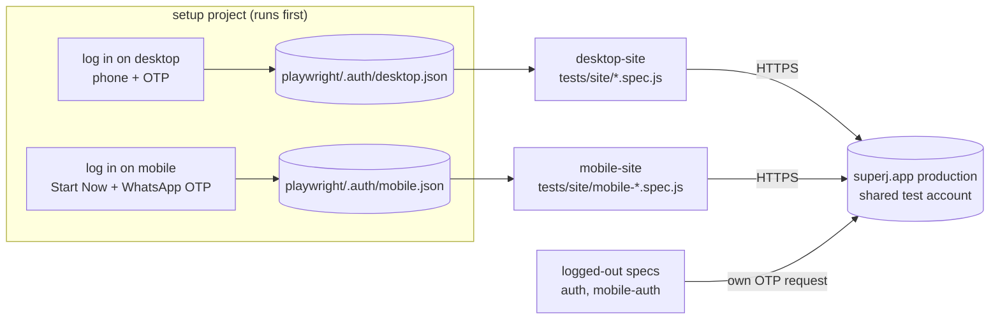
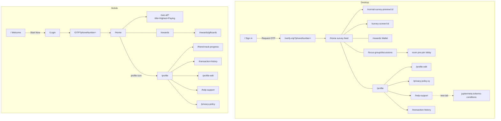

# SuperJ web — test case catalogue

Covers `https://superj.app` as mapped on 2026-09-23, on desktop (Desktop Chrome) and mobile web (Pixel 5).
Desktop and mobile are separate front ends with different pages, so each has its own cases.

- **Automated** cases live in `tests/site/` and run with `npm run test:site`. Each test name starts with its ID.
- **Manual** cases change real data on the production test account (money, rewards, surveys, discussions), so the
  suite never runs them. Run them by hand on a disposable account or a staging environment.
- **Known bug** cases are automated with `test.fail()`. They pass while the bug exists and start failing when it's
  fixed. At that point, delete the `test.fail` line.

## How the suite works

The suite logs in once per layout and reuses the saved session, instead of requesting an OTP for every test. A saved
session stays valid after later logins on the same number, which was confirmed while writing the suite. The older
specs in `tests/*.spec.js` still log in per test.

## Site map

## Desktop — sign-in (logged out) · `tests/site/auth.spec.js`

| ID | Priority | Case | Expected |
|---|---|---|---|
| TC-AUTH-01 | High | Open `/` | Title "Welcome to SuperJ", heading "Sign in", +91 prefix, OTP hint and an enabled Request OTP button |
| TC-AUTH-02 | Medium | Type letters and symbols into the phone field | Field stays empty |
| TC-AUTH-03 | Low | Type 14 digits | The field keeps at most 10 digits |
| TC-AUTH-04 | High | Request OTP with an empty number, then with `12345` | "Please enter a valid phone number" is shown and the page doesn't advance |
| TC-AUTH-05 | High | Request OTP for the test number, then enter `000000` | `/verify-otp?phoneNumber=…`, "Enter OTP", the number is shown, six 1-character boxes, "Resend OTP in Ns" countdown, "invalid otp" shown and the page stays put |
| TC-AUTH-06 | High | Open `/Home`, `/rewards`, `/profile`, `/transaction-history` logged out | Redirected to the sign-in page |
| TC-AUTH-07 | High | Open `/focus-group/discussions` and `/profile-edit` logged out | No user or discussion data is shown |
| TC-AUTH-08 | Medium | Same two routes | Should redirect to sign-in. **Known bug BUG-02** |

## Desktop — navigation · `tests/site/navigation.spec.js`

| ID | Priority | Case | Expected |
|---|---|---|---|
| TC-NAV-01 | High | Sidebar items | Home, Wallet, Discussions, Profile, in that order |
| TC-NAV-02 | High | Click each sidebar item | `/Home` "Home \| SuperJ", `/rewards` "Rewards \| SuperJ", `/focus-group/discussions`, `/profile` "My Profile \| SuperJ" |
| TC-NAV-03 | Medium | Copy DID in the sidebar | Sidebar shows `did:zkjm:superj:...`; clipboard holds the full `did:zkjm:superj:<40 hex>` |
| TC-NAV-04 | Low | Download the App | QR-code modal with instructions; it closes |
| TC-NAV-05 | Medium | Open `/OnBoarding` while logged in | Redirected to `/Home` |
| TC-NAV-06 | Low | Open an unknown route | A not-found page should appear. **Known bug BUG-03** |

## Desktop — Home and surveys · `tests/site/home.spec.js`

| ID | Priority | Case | Expected |
|---|---|---|---|
| TC-HOME-01 | High | Open Home | "Welcome to SuperJ!" and the tagline |
| TC-HOME-02 | High | Survey cards | Each shows "N people have taken this survey", "Earn N", "Answer N questions…" and Start Survey |
| TC-HOME-03 | High | Start Survey on the first card | Preview page `/normal-survey-preview/:id` with the same title, "₹ N CASH REWARD" matching the card, estimated time, consent notice and START SURVEY. A survey already started resumes at `/survey-screen/:id` with an n/m counter. **START SURVEY is never pressed.** |
| TC-HOME-04 | Medium | Open `/start-survey` | Sponsored Karnataka study consent page with an anonymity notice and Start Survey |

## Desktop — Wallet · `tests/site/wallet.spec.js`

| ID | Priority | Case | Expected |
|---|---|---|---|
| TC-WAL-01 | High | Wallet balance | ₹ amount matches "You have ₹N in your Wallet!" |
| TC-WAL-02 | High | Cash-out rule after load | Shows a non-zero minimum (currently ₹250) |
| TC-WAL-03 | High | Cash Out button | Visible and enabled. Not clicked. |
| TC-WAL-04 | Medium | Know more | "How to withdraw your cash?" explanation |
| TC-WAL-05 | Medium | Sort | Offers Recently Added and Expiring Soon |
| TC-WAL-06 | Medium | See More | More gift cards appear |
| TC-WAL-07 | Medium | Open a gift card | Expiry date, redemption info and Copy; Close dismisses it. **The test never reads or logs the code or PIN.** |
| TC-WAL-08 | Medium | Know more minimum vs cash-out rule | Should quote the same amount. **Known bug BUG-04** |

## Desktop — Discussions (account has moderator access) · `tests/site/discussions.spec.js`

| ID | Priority | Case | Expected |
|---|---|---|---|
| TC-DIS-01 | High | Open Discussions | "Discussions!", "Moderator View", Live / Scheduled / New tabs |
| TC-DIS-02 | Medium | Live tab | Rooms with time slot and Start Discussion, or "No live sessions right now" |
| TC-DIS-03 | Medium | Scheduled tab | Upcoming rooms or "No upcoming discussions at the moment." |
| TC-DIS-04 | High | New tab | Create form with Title, Description, Discussion type, Max Spots ("Max 10"), Date, Time, Camera required and Create Discussion. **Not submitted.** |
| TC-DIS-05 | Medium | Open a live room | Pre-join lobby with room link, Microphone / Camera / Recording setup and Join Discussion. **Join isn't pressed.** Skipped when no room is live. |

## Desktop — Profile, Help, History · `tests/site/profile.spec.js`

| ID | Priority | Case | Expected |
|---|---|---|---|
| TC-PRO-01 | High | Decentralised ID | Full `did:zkjm:superj:<40 hex>` shown |
| TC-PRO-02 | Low | Learn more about DID | "Your Decentralised ID" and privacy bullets |
| TC-PRO-03 | Medium | Refer a friend banner | Copy Link, Email, Messages, WhatsApp |
| TC-PRO-04 | High | Personal info | Gender, Birth Year (4 digits), City, "created this account on DD Mon YYYY" |
| TC-PRO-05 | High | Edit | `/profile-edit` with Email ID and Save. **Not saved.** |
| TC-PRO-06 | Low | Privacy Policy | `/privacy-policy-sj` with the policy sections |
| TC-PRO-07 | Medium | Transaction History → View All | `/transaction-history` |
| TC-PRO-08 | High | Logout → Cancel | "Sure you want to logout?" dialog; Cancel keeps you on `/profile`, logged in |
| TC-HELP-01 | Low | FAQs | Six questions; clicking one reveals its answer |
| TC-HELP-02 | Medium | Contact Us | "Ask a question" form, textarea capped at 300 characters, Send button. **Not sent.** |
| TC-HELP-03 | Low | Terms & Conditions | Opens `jupitermeta.io/terms-conditions` in a new tab |
| TC-TXN-01 | High | History entries | Title, "Survey" type, +reward, date; newest first |
| TC-TXN-02 | Medium | Show More | Older entries load |

## Desktop — page health · `tests/site/health.spec.js`

| ID | Priority | Case | Expected |
|---|---|---|---|
| TC-HLT-01 | Medium | Load each logged-in route (8 routes) | No uncaught JS errors and no 5xx from `*.superj.app`. `/profile` and `/transaction-history` are **known bug BUG-05** |

## Mobile — sign-in (logged out) · `tests/site/mobile-auth.spec.js`

| ID | Priority | Case | Expected |
|---|---|---|---|
| TC-MAUTH-01 | High | Open `/` | "Welcome to Super J", "earn upto ₹500 every month!", Download App, Start Now, language tags |
| TC-MAUTH-02 | High | Start Now | `/Login`, title "Login \| SuperJ", "Your Phone Number", +91, Continue |
| TC-MAUTH-03 | High | Continue with an empty number, then `12345` | "Please enter a valid phone number"; stays on `/Login` |
| TC-MAUTH-04 | Medium | Type letters | Field stays empty |
| TC-MAUTH-05 | High | Continue with the test number, enter `000000`, press Back | `/OTP?phoneNumber=…`, "Confirm Your Number", "sent on WhatsApp", formatted number, "Retry in 00:NN", one 6-character field, error message, Back returns to `/Login` |

## Mobile — logged in · `tests/site/mobile-app.spec.js`

| ID | Priority | Case | Expected |
|---|---|---|---|
| TC-MHOME-01 | High | Chrome | Profile icon on top; bottom nav with Home and Wallet (no Discussions on mobile) |
| TC-MHOME-02 | High | Home sections | "Refer the app for ₹N" + Refer now; Recommended for You, Highest Paying, Share & Earn |
| TC-MHOME-03 | High | Bottom nav | Wallet → `/rewards`, Home → `/Home` |
| TC-MHOME-04 | Medium | Highest Paying | `/see-all?title=Highest+Paying` with High to Low / Low to High |
| TC-MHOME-05 | Medium | Each sort order | Survey rewards come back in the chosen order |
| TC-MWAL-01 | High | Wallet | Balance, non-zero cash-out minimum, Cash Out. Not clicked. |
| TC-MWAL-02 | Medium | Know more | "Redeem Gift Card" sheet quoting the same minimum as the cash-out rule; Turn On Notifications |
| TC-MWAL-03 | Medium | View all gift cards | `/rewards/giftcards` with Sort and voucher list |
| TC-MWAL-04 | Low | Referral banner | "Refer & Earn Amazon Pay ₹N" |
| TC-MPRO-01 | High | Profile | DID banner, Refer & Earn Program, Refer a friend, My History, Personal Information (Gender, Birth Year, City), Account |
| TC-MPRO-02 | Low | Track Progress | `/friend-track-progress` referral FAQ |
| TC-MPRO-03 | Medium | My History | `/transaction-history` with Transactions and Verifications tabs, dated entries |
| TC-MPRO-04 | High | Edit | `/profile-edit`, optional email capped at 100 characters, Done. **Not saved.** |
| TC-MPRO-05 | Low | Help and Support, Privacy Policy | `/help-support` (FAQs) and `/privacy-policy` |
| TC-MPRO-06 | High | Logout → Cancel | Confirmation dialog; Cancel keeps you logged in |

## Manual cases — never automated against production

These cases change money, rewards or shared data on the one test account.

| ID | Area | Case | Expected |
|---|---|---|---|
| MAN-01 | Auth | Correct OTP after the resend countdown expires, then Resend OTP | A new OTP is sent and the countdown restarts |
| MAN-02 | Auth | Enter a wrong OTP repeatedly | Lockout or rate-limit message, if the product has one |
| MAN-03 | Auth | Logout → "Yes, I'll be back" | Session ends; protected routes redirect to sign-in |
| MAN-04 | Wallet | Cash Out below the minimum | Blocked with a clear message |
| MAN-05 | Wallet | Cash Out above the minimum | Gift-card purchase flow; balance goes down by the amount |
| MAN-06 | Wallet | Copy a gift-card code / PIN | Clipboard holds the code; "Copied" feedback |
| MAN-07 | Survey | Press START SURVEY and answer every question | Reward credited; entry appears in Transaction History |
| MAN-08 | Survey | Next without choosing an answer; fail the attention check | Validation or disqualification behaviour |
| MAN-09 | Profile | Edit gender, birth year, city, email → Save/Done | Values persist after reload; invalid email rejected |
| MAN-10 | Help | Contact Us → Send | Confirmation; support receives the message |
| MAN-11 | Discussions | Create Discussion (moderator) | Room appears under Scheduled/Live; field validation (Max Spots > 10, past date) |
| MAN-12 | Discussions | Start / Join Discussion | Mic/camera permission prompts; room joins |
| MAN-13 | Discussions | More options → Delete Room | Confirmation, then the room is removed |
| MAN-14 | Refer | Copy Link / WhatsApp / Email share | Correct referral link shared |
| MAN-15 | Mobile | Download App / Open in App | Opens the right store or deep link |
| MAN-16 | Mobile | Share & Earn → Share & earn | Share sheet with the survey link |

## Bugs found while mapping the site

| ID | Severity | Where | What happens | Test |
|---|---|---|---|---|
| BUG-01 | Low | Wallet, both layouts | Cash-out rule briefly shows "minimum of ₹0" before loading the real ₹250 | TC-WAL-02 waits for the real value |
| BUG-02 | Medium | `/focus-group/discussions`, `/profile-edit` logged out | App shell renders instead of redirecting to sign-in (other protected routes redirect). No user data is exposed. | TC-AUTH-08 |
| BUG-03 | Low | Any unknown route | Empty layout, no 404 message | TC-NAV-06 |
| BUG-04 | Medium | Wallet copy | Desktop Know more says a gift card needs ₹100; the cash-out rule and mobile Know more say ₹250; the mobile "Withdraw Faster!" promo says "cash out at ₹100" | TC-WAL-08 |
| BUG-05 | Low | Desktop `/profile`, `/transaction-history` | React error #418 (server/client HTML mismatch) on every load. **Likely** caused by locale-formatted dates. | TC-HLT-01 |

## Notes for maintainers

- **Invisible overlay:** many mobile buttons and links sit under an invisible `<input switch>` (an iOS haptic
  trick). Real taps work, but Playwright's normal `click()` refuses. Use `tap()` from `utils/ui.js`.
- **Accessible names:** buttons include icon alt text ("edit Edit"), so exact role names miss them. Use `button()`
  from `utils/ui.js` or `hasText` filters.
- **Content changes:** survey titles, rewards, balances and live rooms change daily. Tests assert structure and
  formats, not specific values.
- **Voucher secrets:** gift-card modals show live voucher codes and PINs, and failure screenshots of TC-WAL-07 could
  capture one. Treat `playwright-report/` and `test-results/` as sensitive; CI uploads the report as an artifact.
